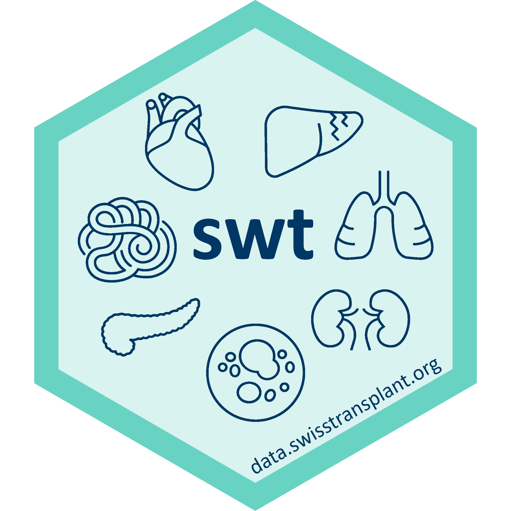

Below is a list of software tools available for download to support data analysis and research activities at Swisstransplant.

## Statistics software

The statistics software supports statistical reporting for research projects and national organ donation and transplantation statistics. It also supports the development of analytical tools at Swisstransplant, including dashboard applications.

-   The R Project for Statistical Computing <https://stat.ethz.ch/CRAN/>
-   Quarto <https://quarto.org/docs/download/>
-   RStudio Desktop <https://docs.posit.co/ide/user/download.html>

::: {.callout-tip appearance="simple"}
Older versions of RStudio Desktop for Windows 11 required administrator privileges for installation. If needed, the ZIP archive version can be used without installation.
:::

## Development software

Additional software used for the development of this website and the `swt` R package is listed below; these tools are only required for users contributing to the website or developing the package.

-   Git version control system <https://git-scm.com/downloads>
-   Pandoc <https://pandoc.org/installing.html>

## Swisstransplant R package

{height="2in" style="float:right; padding:0px"}

The Swisstransplant R package `swt` is the Swiss army knife for data analysis at Swisstransplant, providing a comprehensive collection of tools for data analysis, reporting, and research. It can be installed in R as follows:

``` r
remotes::install_github("Swisstransplant/swt")
```

The package is under constant development and includes the following features:

-   A Swisstransplant project template for Quarto documents and presentations
-   The Swisstransplant color scheme and `ggplot2` style
-   Helper functions for descriptive statistics, missing data analysis, regression modeling, and formatting *p*-values
-   Calculators for the KIDMO risk score, eGFR, the US KDRI, and the UK KDRI
-   Tools to read and process data from the LifePort kidney transporter
-   An HLA mismatch calculator for antigen data in the format used by SOAS

The source code is available on [GitHub](https://github.com/Swisstransplant/swt). There is a [package manual](https://github.com/Swisstransplant/swt/blob/main/manual/swt.pdf).

## R Cookbook

The [R Cookbook](https://swisstransplant.github.io/rcookbook/) provides practical examples demonstrating how to use the `swt` package to create high-quality reports and publication-ready graphics using the Swisstransplant style.
